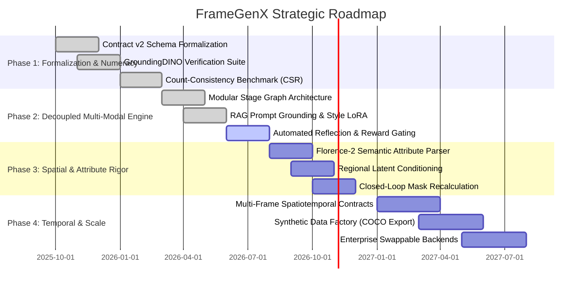

# 01_VISION.md — Mission, Strategic Direction, and Core Philosophy

---

## 1. Executive Summary & Mission

### 1.1 The Mission
The mission of **FrameGenX** is to transition generative visual AI from an unconstrained, probabilistic art form into a **deterministic, verifiable engineering discipline**. 

Modern text-to-image (T2I) systems—including diffusion models, flow-matching architectures, and autoregressive visual generators—treat natural language prompts as stochastic seeds. They optimize for perceptual aesthetics (Fréchet Inception Distance, aesthetic reward models, human preference scores) rather than strict logical execution.

FrameGenX replaces open-loop **"Prompt-Driven Generation"** with closed-loop **"Contract-Driven Visual Generation and Verification"**. By treating human intent as a formal, machine-readable computational contract and visual generation as a multi-stage compilation and verification pipeline, FrameGenX enables autonomous software agents, synthetic data pipelines, and mission-critical enterprise workflows to rely on visual outputs with quantified, measurable reliability.

```
+---------------------------------------------------------------------------------------+
|                                PROMPT-DRIVEN (STATUS QUO)                              |
|  [Prompt] ----> [Monolithic Diffusion Model] ----> [Unverified Image]                  |
|                 (Stochastic Latent Sampling)       ("Hope-based" Quality)             |
+---------------------------------------------------------------------------------------+
                                           VS
+---------------------------------------------------------------------------------------+
|                                CONTRACT-DRIVEN (FRAMEGENX)                            |
|  [Intent] ──> [Contract] ──> [Spatial Plan] ──> [Enforced Render]                     |
|                                                       │                               |
|                                                       ▼                               |
|  [Accepted Image + Receipt] <── [Pass] <── [Independent Verification]                 |
|                                     │                                                 |
|                                     └─── [Fail] ──> [Autonomous Repair Loop]          |
+---------------------------------------------------------------------------------------+
```

---

## 2. The Core Philosophy

FrameGenX operates on five foundational axioms:

### Axiom 1: Contracts Are the Single Source of Truth
Natural language is inherently ambiguous, context-dependent, and non-deterministic. A paragraph of text cannot serve as a reliable specification for spatial positioning, object counts, attribute bindings, or depth ordering. In FrameGenX, **if a constraint is not explicitly declared in the contract, it does not exist; if a constraint is declared, its satisfaction must be verifiable.** Prompts are treated merely as transient compilation artifacts derived from contracts.

### Axiom 2: Generation Alone is Insufficient (Verification is First-Class)
A generative model is fundamentally an associative rendering engine with high perceptual capability and zero intrinsic guarantee of logical correctness. An unverified visual generation is an uncompiled code snippet. Visual generation cannot be considered complete until an independent, decoupled verification suite evaluates the artifact against the initial contract.

### Axiom 3: Success Metric is Constraint Satisfaction Rate (CSR), Not Aesthetics
The primary optimization target of FrameGenX is **Constraint Satisfaction Rate (CSR)**—the mathematical ratio of verified constraints satisfied by the output over total constraints specified in the contract:
$$\text{CSR} = \frac{1}{|\mathcal{C}|} \sum_{c_i \in \mathcal{C}} \mathbb{I}(\mathcal{V}(c_i, \mathcal{I}) \ge \tau_i)$$
A visually stunning image that renders four cars when three were contracted is a **failed execution**. A rudimentary image that rigorously fulfills 100% of spatial, numeric, and relational constraints is an **acceptable compilation**.

### Axiom 4: Assume Failure — Design for Closed-Loop Repair
Hallucination elimination in generative deep learning is a theoretical impossibility given continuous latent sampling. FrameGenX assumes that generation *will* fail on non-trivial compositional tasks. The architecture is explicitly engineered around **Autonomous Closed-Loop Repair (Generate $\to$ Verify $\to$ Reflect $\to$ Repair $\to$ Accept)**, mathematically diagnosing discrepancies and executing targeted spatial/conditioning interventions.

### Axiom 5: Hardware Accessibility as an Architectural Constraint
Research platforms that depend on 80GB H100 GPU clusters fail to democratize engineering practices. FrameGenX mandates that its reference architecture, local runtime, and verification loops operate within standard consumer hardware constraints (**6GB VRAM, 16GB System RAM, e.g., RTX 3050 Laptop GPU**). Modularity, aggressive memory lifecycle management, and sequential model orchestration are core architectural requirements.

---

## 3. Long-Term Vision: The Visual Compiler for Autonomous Systems

FrameGenX envisions a software ecosystem where generating a visual scene is as predictable and testable as compiling an abstract syntax tree (AST) in a modern programming language.

```
       [Software Engineering]                      [FrameGenX Visual Engineering]
  Source Code (.ts, .rs, .py)                 Human Intent / Autonomous Agent Goal
               │                                                │
               ▼                                                ▼
   Abstract Syntax Tree (AST)                      Declarative Contract (JSON Schema)
               │                                                │
               ▼                                                ▼
 Intermediate Representation (IR)              Spatial Scene Plan (Masks, Depth, Poses)
               │                                                │
               ▼                                                ▼
 Machine Code Generation (LLVM)                Latent Rendering (Diffusion / Flow Matching)
               │                                                │
               ▼                                                ▼
  Unit Tests & Static Analysis                 Vision-Language Verification & Metrics
               │                                                │
               ▼                                                ▼
  Compiled Binary / Test Report                Verified Visual Asset + Audit Receipt
```

### Future Paradigms Enabled by FrameGenX:
1. **Zero-Human-in-the-Loop Synthetic Data Generation**:
   Computer vision models for robotics, aerospace, medical imaging, and autonomous vehicles require millions of annotated images. FrameGenX generates pixel-perfect images alongside mathematically verified, zero-drift bounding boxes and segmentation masks natively extracted from the Contract and Verification layers.
2. **Autonomous Agent Visual Cortex**:
   Large Action Models (LAMs) and multi-agent frameworks requiring visual output generation (e.g., automated UI design, pedagogical diagram generation, architectural drafting) interact with FrameGenX via standard RPC/REST contracts, receiving deterministic exit codes and structured discrepancy reports rather than unvalidated pixels.
3. **Temporal & Spatio-Temporal Continuity**:
   Extending the Contract Specification from $2D$ spatial coordinates $(x, y, w, h)$ to $3D+T$ spatiotemporal manifolds $(x, y, z, t, \vec{v})$, enabling guaranteed character identity persistence, camera trajectory control, and cinematic continuity across hundreds of sequential frames.

---

## 4. Strategic Direction & Phased Evolution



### Strategic Milestones:
- **Phase 1 (Formalization & Baseline Isolation)**: Prove that contract-driven isolation solves discrete object counting on consumer GPUs with statistical significance ($p < 0.01$).
- **Phase 2 (Stage-Graph Runtime & Closed-Loop Reflection)**: Establish the pluggable `Stage` pipeline, reproducible artifact logging (`runs/<id>/`), SQLite run tracking, and reward-gated repair loops.
- **Phase 3 (Fine-Grained Attribute & Spatial Disentanglement)**: Eliminate cross-attribute contamination (prompt bleed) via regional attention masking and automated bounding box re-planning.
- **Phase 4 (Temporal Continuity & Enterprise Synthesis)**: Expand contracts to multi-scene storyboarding, persistent character embeddings, and high-throughput synthetic dataset generation.
